# MinnieML: Compiler Implementation

This document describes how the MML compiler processes programs: the tree it works on, the main
rewrites it performs, and how those rewrites flow into codegen.

The compiler uses one evolving AST from parsing through codegen. There is no separate core tree or
mid-level IR between the frontend and backend. Phases keep rewriting the same lambda-shaped model:
they add synthetic nodes, assign stable IDs, record captures, attach metadata, insert ownership
wrappers, and annotate types in place.

## Table of contents
6. [AST structure](#6-ast-structure)
7. [Parser architecture](#7-parser-architecture)
8. [Stages and semantic pipeline](#8-stages-and-semantic-pipeline)
9. [Standard library injection](#9-standard-library-injection)
10. [Error handling strategy](#10-error-handling-strategy)
11. [Code generation: native templates](#11-code-generation-native-templates)
12. [Code generation: struct constructors](#12-code-generation-struct-constructors)
Appendix A. [Source tree overview](#appendix-a-source-tree-overview)

---

## 6. AST structure

The Abstract Syntax Tree is organized into several node categories.

### Core traits

#### `AstNode`
Base trait for all AST nodes.

#### `FromSource`
Nodes that have source location information (`SrcSpan`).

#### `Typeable`
Nodes that can have types, containing:
- `typeSpec: Option[TypeSpec]` - **Computed type** by the compiler
- `typeAsc: Option[TypeSpec]` - **User-declared type** from source

#### `Resolvable`
Nodes that can be referenced by name (all `Decl` types, `FnParam`). Each `Resolvable` (and
`ResolvableType`) carries a stable `id: Option[String]` used for soft references.

### Module structure

```scala
Module(
  span: SrcSpan,
  name: String,
  visibility: Visibility,  // Public, Protected, Private
  members: List[Member],
  docComment: Option[DocComment],
  sourcePath: Option[String],
  resolvables: ResolvablesIndex,
  linkDirective: Option[LinkDirective]
)
```

- **Top-level modules**: The CLI/test harness always provides a module name derived from the source path; there is no `module` keyword at file scope. The parser reads the optional link header and top-level members until EOF, wrapping them in a `Module`.
- **Link header**: One optional `@link["name", ...];` precedes the members. `LinkDirective`
  retains its span and ordered `LinkEntry` values, each with a name and source span.
  Ingestion copies entries into `CompilerState.linkEntries`; semantic module copies preserve
  the header. Malformed or misplaced headers produce recoverable `ParsingMemberError` nodes.
- **Doc comments**: File-level doc comments apply to the first member; the parser does not attach them to the synthetic top-level module node.
- **Visibility**: The AST records three levels (`Public`, `Protected`, `Private`), but access restrictions are not yet enforced. See semantics doc for meaning.

### Members

Top-level declarations in a module:

#### Declarations (`Decl`)
All declarations extend `Decl` trait and include:
- `Bnd` - All value bindings, functions, and operators (with `Lambda` body and optional `BindingMeta`)
- `TypeDef` - New type definitions
- `TypeAlias` - Type aliases

**Bnd with BindingMeta**: Functions and operators are represented as `Bnd` nodes containing a `Lambda` body and `BindingMeta`:
```scala
Bnd(
  name: String,           // mangled name for operators (e.g., "op.plus.2")
  value: Expr,            // contains Lambda with params and body
  meta: Option[BindingMeta], // origin, arity, precedence, associativity, originalName, inlineHint
  id: Option[String]         // stable soft-reference ID
)
```


### Terms

Expressions are built from terms:

#### Expression structures
- **`Expr`**: Sequence of terms that form an expression
- **`TermGroup`**: Parenthesized expression `(expr)`
- **`Cond`**: Conditional expression `if cond then expr1 else expr2`
- **`App`**: Function application (curried: `f x y` becomes `((f x) y)`)
  - The `fn` field uses `Callee`, an alias for `Ref | App | Lambda`; parser-lowered scoped
    bindings and direct lambda application rely on the `Lambda` case.
- **`Lambda`**: First-class callable value used for:
  - top-level `fn` / `op` bodies wrapped in `Bnd`
  - literal lambdas (`{ x -> body }`, `~{ x -> body }`)
  - local `fn` sugar lowered by the parser to a scoped binding of a `Lambda`
  - synthetic statement / let wrappers introduced during parsing and later rewrites
  - Carries `params`, `body`, `captures`, optional `LambdaMeta`, and `isMove` for explicit move
    capture syntax
- **`YieldOwnership`**: Supplies a value and a Boolean ownership witness at a scoped result.
- **`BindOwnership`**: Evaluates an initializer that yields both results, binds its value and
  witness parameters, and evaluates one continuation body. These ownership-analysis nodes keep
  the original value type; they do not introduce a source tuple or a function-return ABI.

#### Closure captures

```scala
enum Capture:
  case CapturedRef(ref: Ref)
  case CapturedLiteral(ref: Ref, cloneFnId: String)
  case CapturedConditional(ref: Ref, witness: Ref, cloneFnId: String)
  case OwnedClosure(ref: Ref, targetId: String)
  case BorrowedRef(ref: Ref)
```

- `CapturedRef` is the regular capture path.
- `CapturedLiteral` marks a captured value that must be cloned when the closure environment is
  materialized.
- `CapturedConditional` uses a resolved creation-scope witness to move the owned alternative or
  clone the literal alternative. The environment receives an owned payload, without a witness
  field.
- `OwnedClosure` records a function capture whose ownership transfers to the environment,
  including the resolved destructor target ID used for cleanup.
- `BorrowedRef` records a capture that does not transfer ownership to the environment.
- The parser always emits `captures = Nil`; later semantic phases discover, classify, and type
  captures.

#### Values
- **`Ref`**: Reference to a declaration or parameter
  - Contains `resolvedId: Option[String]` - ID of the resolved target (soft reference)
  - Contains `candidateIds: List[String]` - potential resolution IDs during name resolution
- **`LiteralInt`, `LiteralFloat`, `LiteralString`, `LiteralBool`, `LiteralUnit`**
- **`Tuple`**: Tuple of expressions `(expr1, expr2, ...)`
- **`Placeholder`**: Pattern matching placeholder `_`
- **`Hole`**: Typed hole `???` (for incomplete code)

#### Marker nodes
- **`DataConstructor`**: Marker node for struct constructor bodies. It is not a callable
  function. It tells codegen to emit struct assembly in the enclosing function
  (alloca, store fields, load, return). The constructor's parameters become the field values.
  Only appears as the sole term in a generated `__mk_StructName` function body.

#### Destruction operations

These compiler-internal expressions all return `Unit`:

- **`DestroyClosure`** evaluates a function operand once, extracts its environment pointer,
  and calls a destructor identified by its resolved ID.
- **`DestroyClosureEnvironment`** takes a `RawPtr` operand, a layout ID, and ordered field
  cleanup entries. It destroys those fields and then releases the environment storage.
- **`DispatchClosureDestructor`** takes a `RawPtr` operand. Null is a no-op; otherwise it
  invokes the destructor pointer stored in the environment, which owns the storage release.

Field cleanup entries identify both the field and destructor by stable IDs. `Value` entries
call native or struct destructors; `Closure` entries destroy owned function captures.
Ordinary struct destructors contain generated field calls and `DestroyClosure` operations in
field declaration order. `StructDestructorBodyGenerator` completes function-bearing struct
bodies after closure helpers are registered and before ownership analysis. Function fields have
resolved field IDs, and the resolvables index includes their declarations.

### Type Specifications (`TypeSpec`)

```scala
// Type references
TypeRef(name: String, resolvedId: Option[String], candidateIds: List[String])

// Native types (from C/LLVM)
NativePrimitive(llvmType: String)        // e.g., "i64", "float"
NativePointer(llvmType: String)          // e.g., "*i8"
NativeStruct(fields: Map[String, TypeSpec])

// Function types
TypeFn(paramTypes: List[TypeSpec], returnType: TypeSpec)

// Compound types
TypeTuple(elements: List[TypeSpec])
TypeStruct(fields: List[(String, TypeSpec)])
Union(types: List[TypeSpec])             // Int | String
Intersection(types: List[TypeSpec])      // Readable & Writable
TypeApplication(base: TypeSpec, args: List[TypeSpec])

// Type schemes (polymorphism)
TypeScheme(vars: List[String], bodyType: TypeSpec)  // forall 'T. 'T -> 'T
TypeVariable(name: String)                          // 'T, 'R, etc.
```

- **Type definitions**: `TypeDef`, `TypeAlias`, and `TypeStruct` are `ResolvableType` nodes with
  stable IDs; `Field` (struct fields) is also `Resolvable` and carries an ID.

### Error/invalid nodes

For error recovery and LSP support:

- **`InvalidExpression`**: Wraps unresolvable expressions
- **`UndefinedTypeError` / `AmbiguousTypeError`**: Retain failed type references, diagnostic
  roots, and matching candidates for ambiguity
- **`DuplicateMember`**: Marks duplicate declarations
- **`InvalidMember`**: Members with structural errors
- **`ParsingMemberError`**: Parse errors at member level
- **`ParseTermError`**: Expression-level parse errors
- **`ParseTypeError`**: Malformed type syntax, retaining source, failed text, and diagnostic roots

### Soft references and ResolvablesIndex

- All resolvable nodes (top-level declarations, struct fields, lambda parameters) carry stable IDs.
- `Ref`/`TypeRef` store those IDs (`resolvedId`/`candidateIds`) instead of object references.
- `Module.resolvables: ResolvablesIndex` maps IDs to the current AST nodes and is kept in sync as
  phases rewrite members. Consumers (LSP, codegen, printers) always reify through this index to get
  the latest node instance.

Binding IDs are readable allocation paths. Initial parameter IDs include the enclosing declaration,
ordinal lambda-scope segments, and parameter name. Anonymous and parameterless lambdas introduce
scopes as well. Generated locals add a `generated::<purpose>::<ordinal>` segment. Top-level
declaration and field IDs retain their declaration-based naming conventions. `BindingIds.declaration`
provides the shared declaration format used by definitions, references, and allocation owners.

`BindingIdSupply` carries allocation history immutably through `CompilerState` and allocating
rewrites. It reserves IDs from definitions in the AST, including definitions missing from a stale
index. Branch traversal and repeated PAP elaboration share that history. Removing a definition
does not make its ID available for reuse. IDs remain stable during a compilation; their spelling
is not a cross-compilation interface.

The path records allocation provenance. Updating or relocating an existing definition preserves
its ID; constructing a distinct binding allocates a fresh ID and matching references. `LocalBindings`
provides generated parameter/reference construction, and reports a construction error when asked
to reference an unassigned parameter. References retain `resolvedId` across definition updates.
Generated locals that replace an expression receive its source origin through `LocalBindings.local`.
Their references and expression wrappers carry `SourceOrigin.Derived`: diagnostics retain the
original span, while editor lookup
and semantic tokens do not mistake the generated reference for written syntax. Generated
parameter declarations and names remain synthetic.

`LocalBindings.bind` constructs an immediate application from an existing parameter, its value,
and a continuation body. It preserves the parameter's identity, annotations, and consuming flag.
The scope receives a `TypeFn` from the parameter's computed or declared input type to the body's
computed result type; the application retains that result type. Before type checking, missing
input or result information leaves the scope untyped for inference. Ownership temporaries and
witnesses, PAP payload bindings, and direct-lambda parameter wrappers share this construction.
Fully applied source-parameter wrappers carry `LambdaMeta.isInvocationParameter`. This preserves
their borrowing contract through the shared scope representation: an unmarked local binding
transfers ownership, while a marked nonconsuming source parameter borrows its argument.

`LocalBindings.sequence` allocates a discard parameter for a Unit-valued effect and runs the
continuation afterward. It preserves the continuation's result type and ascription. Ownership
cleanup and closure-invocation disarming use this operation; generated struct destructors use
`LocalBindings.cleanup` to sequence field destruction in declaration order and return Unit.

Nested allocation uses the prefix of the first assigned parameter as its scope anchor. For a
generated parameter, that anchor includes its generation purpose and ordinal. Re-entering the
same definition, including after relocation, yields the same anchor. This gives distinct generated
lambdas distinct provenance without changing the identities already attached to their parameters.

`SemanticStage` publishes fresh indexes at rewriting phase boundaries from initial ID assignment
onward. Phases that rebuild their own output index run directly; other rewrites use the shared
indexing wrapper. Validation-only phases retain their input index. Allocating phases seed ID
history from their input definitions and register new declaration IDs at construction. A phase
that looks up definitions during its own rewrite maintains its intermediate index; PAP
stabilization refreshes between iterations. Reindexing rebuilds ID-to-node mappings only. It does
not assign IDs, remap references, or refresh type information stored on reference nodes.

---

## 7. Parser architecture

The parser uses **FastParse** combinators.

### Whitespace handling

- **No significant indentation**: Whitespace is not syntactically meaningful
- **Custom whitespace handler** (`MmlWhitespace`):
  - Consumes spaces, tabs, newlines, carriage returns
  - Handles line comments starting with `//` (e.g., `// this is a comment`)
  - Preserves `/*` and `*/` tokens for doc comment parser

**Implementation**: State machine with two states:
- State 0: Normal whitespace consumption
- State 1: Inside line comment (consume until newline)

### Source boundaries

Source spans use `[start, end)` offsets: the start belongs to the node and the end is the
first position after its owned syntax. Trailing spaces and line comments do not extend
tokens or successful expressions. Whitespace between owned tokens belongs to the enclosing
span. The module covers the whole input, including leading and trailing trivia.

`tokenP(info)(token)` captures `Index ~~ token ~~ Index` and returns a parser-private
`ParsedToken` containing the value and its exact span. The caller handles leading whitespace;
the token itself must finish at its last character. This wrapper cannot correct a child
parser that already consumed trailing trivia. Native type tokens and closing brackets capture
their endpoints before whitespace-consuming validation.

Composite nodes use their final child's endpoint or an owned delimiter. Groups, tuples, and
lambdas include their closer. Member `let` spans include their semicolon; function and operator
binding spans cover their names, with separate body spans. Functions have distinct body and
declaration semicolons. A conditional includes its last clause's terminator, and its implicit
false branch is zero-width at that endpoint. Attached doc comments retain their own spans and
the existing declaration/parameter coverage rules.

References cover their written names or selection chains. Expression envelopes also cover
consumed annotations. `ParsedTerm` carries the term and syntax endpoint between ascription
parsing and expression-frame construction, including when an error node discards an annotation:

```text
item: Int // trailing comment
^^^^                         Ref
^^^^^^^^^                    Expr

( ): Int;
^^^                          ParseTermError for the empty tuple
^^^^^^^^                     Expr includes the consumed annotation
```

Only written annotations contribute to this endpoint; computed type metadata does not.
Editor reference-target traversal checks a written annotation by its own span, independently
of the reference's name span.
`pointP` reads the raw cursor. Its caller decides whether whitespace is skipped before that
capture, so it is suitable for missing-syntax positions and recovery boundaries, not for
reconstructing a successful child's endpoint.

Expression recovery separates the successful prefix end, scanner start, and scanner end.
It captures scanner start together with the scanner call after normal inter-parser whitespace.
A recovery error requires scanner progress beyond that start. For
`item: Int // comment\n @ bad  ;`, the successful expression ends after `Int`, the error starts
at `@`, and its failed text is exactly `@ bad  `. Scanner-owned malformed text keeps its
whitespace. Missing components can be zero-width; a closed malformed group owns its closing
delimiter. These rules preserve recovery progress while keeping successful spans precise.

### Expression parsing strategy

Expressions are parsed as **sequences of terms** that are later restructured by the `ExpressionRewriter` phase using precedence climbing.

**Example**:
```mml
let result = 1 + 2 * 3;
```
- **Parser output**: `Expr(terms = [Ref("1"), Ref("+"), Ref("2"), Ref("*"), Ref("3")])`
- **After ExpressionRewriter**: Properly nested `App` nodes respecting precedence

**Rationale**: This approach simplifies parsing and defers precedence handling to semantic analysis, enabling better error recovery and making operator precedence extensible.

### Commitment and recovery boundaries

The parameterized lambda arrow commits to its body. Speculative field-selection and group
alternatives contain nested cuts with `NoCut`: a lambda inside parentheses does not require
that the parentheses be followed by a field-selection dot, and a comma can select the tuple
alternative. The sequence lookahead also contains cuts because it only probes for another
expression. These boundaries preserve the existing language and operator precedence.

`Recovery.scan` supplies context-aware synchronization for malformed fragments. Ordinary
anchors apply at delimiter depth zero; hard stops identify tokens excluded from the recovered
construct at every depth. Closed strings and comments mask anchors within their contents. Explicit
lexical-opener anchors can preserve a following declaration's doc comment. The scanner leaves
the anchor or enclosing delimiter unconsumed. Its FastParse adapter uses `NoWhitespace` to
consume exactly the recovered region; a caller that permits a zero-width result must consume
an introducer or boundary before repeating.

Type parsing receives a `TypeContext` describing the surrounding declaration, parameter,
field, alias, operator, group, or expression. A written colon commits locally to a type result;
`NoCut` contains that commitment so speculative lambda and operator alternatives remain
reachable. Missing or malformed fragments produce `ParseTypeError`, retaining an explicit
annotation and its exact source slice. Function types retain valid sibling atoms, and closed
groups retain their nested errors. Balanced malformed fragments become one failed type when
they end at an actual type or caller boundary. If balancing cannot establish that boundary,
hard stops preserve following parameters, fields, and declaration bodies. In expression
ascriptions, a closed malformed type group also preserves subsequent application terms.
Recovery does not introduce tuple-type syntax or invent type components.

Expression ascriptions permit valid following application terms. For ungrouped lambda
parameter types, a type arrow requires a complete valid following atom; otherwise the arrow
remains the lambda body separator. Operator result recovery preserves precedence and
associativity, including adjacent forms such as `60left`. Recovery leaves caller punctuation
and declaration/doc-comment boundaries unconsumed. Missing declaration punctuation remains
the responsibility of the enclosing declaration parser.

Local and member `let`/`fn` parsers commit after their boundary-checked keyword and recover
names, parameter lists, required punctuation, and body frames locally. A binding-header type
context permits a completed annotation before a missing `=`; the missing token becomes a
zero-width `ParseTermError`, leaving the body available for analysis. Failed parameter tails
preserve actual prefix parameters and stop at body punctuation even after an unmatched opener.

Expression frames preserve successfully parsed prefixes as nested `Expr` values followed by
`ParseTermError` nodes. After a nonempty malformed fragment, parsing can resume at a boundary-checked
`if`, whose recursive parser owns its clauses. ID assignment and reference resolution visit
retained children before semantic normalization creates unavailable-result wrappers. Recovery leaves enclosing
delimiters, conditional boundary keywords, and declaration-only introducers to their owners.
Repeated optional frames must advance; required empty frames are permitted only after their
owner consumed an introducer. Functions own separate body and declaration semicolons. Local
`let` and `fn` remain valid body terms, so a missing terminator before either is not treated as
an unambiguous declaration boundary.

Binding frames opt into recovery after a quote with no later closing quote: ordinary nesting
and anchors then apply to the remaining malformed text. This preserves a following declaration
after an unterminated native template. Closed strings, including multiline strings, remain
masked. A later quote can therefore conservatively extend a malformed fragment across lines;
recovery does not infer an intended line-based string boundary.

A complete function header retains its lambda and parameter scope when its body is malformed.
An incomplete header retains only a real nonempty parameter prefix, with its header error in
the body and no complete binding metadata or synthesized callable ascription. With no actual
parameter prefix, recovery preserves a failed named value without inventing a nullary lambda.
Malformed local names use the same synthetic statement application as ordinary sequencing,
retaining initializer/body and continuation without introducing a source-resolvable name.
Nameless local lets retain their written annotation on the statement argument, separately from
any annotation on its initializer. Ingest can therefore report both malformed annotations.
Nameless member errors retain the exact declaration text and subsequent members; their error
carrier does not contain analyzable initializer children.

Expression and member conditionals share clause parsing and lowering. Expression conditions
permit semicolon sequencing; member conditions exclude it. Both use ordinary expression bodies.
After `if`, `elif`, or `else`, local recovery retains missing or malformed components, including
zero-width errors at immediate boundaries and EOF. A missing `then` leaves all parsed terms in
the condition and inserts one true-branch boundary error, without guessing a condition/body split.

An explicit `else` contributes its written body. Without it, the final false branch is a zero-width
Unit expression at the conditional's end. The outer conditional carries Unit ascription and computed
type; nested `elif` conditionals carry only the computed type. Recovery preserves this lowering,
enclosing delimiters, and nested clause ownership. Conditional keywords are ordinary scanner
anchors, not hard stops through unmatched openers; an opaque unmatched delimiter can therefore
hide later clauses until EOF or a mismatched closer.

### Lambda and local-binding lowering

The parser emits `Lambda` terms in expression position.

#### Literal lambdas

Surface syntax:

```mml
{ x -> x + 1 }
~{ x -> mk_user x }
{ println "side effect" }
```

- `{ ... }` creates a borrow-capturing closure by default.
- `~{ ... }` creates a move-capturing closure.
- Parameterless lambdas are allowed.
- Lambda bodies are terminated by `;` or implicitly by the closing `}`.

#### Local `let`

Expression-local bindings are lowered directly to immediate lambda application:

```mml
let x = value;
rest
```

Conceptually:

```mml
({ x -> rest } value)
```

The parser builds this directly as `App(fn = Lambda(...), arg = value)`. Later phases treat that
shape as a scoped-binding lambda: an immediate application that extends the current scope rather
than a value-position lambda that needs closure materialization.

#### Local `fn`

Inner functions use the same scoped-binding lowering strategy:

```mml
fn helper(a: Int): Int = a + 1;
helper 41
```

The bound value is a `Lambda`. When parameter and return annotations are available, the parser also
synthesizes a `TypeFn` ascription for the local binding. That keeps local `fn` and let-bound
lambdas on the same path in later phases.

A malformed written result annotation also stays on the local lambda, independently of that
callable-type synthesis. Missing parameter annotations cannot erase its source diagnostic;
mirrored occurrences of the same malformed annotation receive one ingest root.

#### Statement sequencing

Expression sequences are also lowered immediately by the parser using the same scoped-lambda model.

Surface syntax:

```mml
expr1;
expr2;
expr3
```

is lowered conceptually to nested immediate applications:

```mml
({ __stmt: Unit ->
   ({ __stmt: Unit ->
      expr3
    } expr2)
 } expr1)
```

The parser builds this shape directly with a synthetic `__stmt` parameter and nested
`App(fn = Lambda(...), arg = ...)` nodes. It is CPS-like in the narrow sense that each statement
runs before the rest of the expression continues. It uses the same AST as the rest of the compiler.

### Member parsing

Top-level module members are parsed independently:
- `fnKw` -> `Bnd` with `Lambda` body and `BindingMeta(origin=Function)`
- `opKw` -> `Bnd` with `Lambda` body and `BindingMeta(origin=Operator)`
- `letKw` -> `Bnd` (no meta for simple value bindings)
- `typeKw` -> `TypeDef` or `TypeAlias`
- `structKw` -> `TypeStruct`

An optional `inline` keyword before `fn` or `op` sets `BindingMeta.inlineHint = true`.
Codegen emits the LLVM `inlinehint` function attribute for these declarations.

### Struct constructor synthesis

Constructor `Bnd` nodes are generated by `ConstructorGenerator`, a semantic phase that runs
after `TypeResolver` and before `MemoryFunctionGenerator`. See Semantic Phase 4 below for
details.

- **Name**: `__mk_StructName` (stored in `BindingMeta.mangledName`). The struct's own name is
  kept in `BindingMeta.originalName` so `RefResolver` can match `User x y` to `__mk_User`.
- **Parameters**: One `FnParam` per struct field, preserving field names and type ascriptions.
- **Body**: A single `DataConstructor` term with the struct's return type. This marker tells
  codegen to emit struct assembly rather than compiling a regular function body.
- **Metadata**: `origin = BindingOrigin.Constructor`, arity derived from field count
  (Nullary/Unary/Binary/Nary), `precedence = Precedence.Function`.
- **Visibility**: Inherited from the struct definition.

The resulting `Bnd` wraps a `Lambda` (params + body) just like user-written functions, so
all downstream phases (RefResolver, TypeChecker, etc.) process it uniformly.

---

## 8. Stages and semantic pipeline

The compiler runs as a series of **stages**, each composed of timed **phases** that transform a
shared `CompilerState`. Stages:
- **IngestStage**: parse source, collect parser counters, and lift parse errors.
- **SemanticStage**: rewrite the AST and resolvables index through semantic phases.
- **CodegenStage**: validate, resolve target info, emit IR, and optionally build native artifacts.

`CompilerState` is the single threaded state that flows across all stages:

```scala
case class CompilerState(
  module:         Module,
  sourceInfo:     SourceInfo,
  config:         CompilerConfig,
  diagnostics:    DiagnosticStore,
  warnings:       Vector[CompilerWarning],
  timings:        Vector[Timing],
  counters:       Vector[Counter],
  entryPoint:     Option[String] = None,
  canEmitCode:    Boolean = false,
  llvmIr:         Option[String] = None,
  nativeResult:   Option[Int] = None,
  resolvedTriple: Option[String] = None,
  clangTarget:    Option[ClangTarget] = None,
  bindingIds:     BindingIdSupply = BindingIdSupply(),
  linkEntries:    List[LinkEntry] = Nil
)
```

Each phase takes a `CompilerState`, returns an updated `CompilerState`, and records timing through
`CompilerState.timePhase` / `timePhaseIO`.

`SemanticStage.rewrite` runs after stdlib injection and wires phases in this order:
0. **Stdlib injection**: Adds prelude types, operators, and functions (with stable `stdlib::<name>` IDs).
   `CString` is an owned native byte pointer. `to_cstr` borrows a `String` and returns an
   allocated copy; its consuming `free_cstr` destructor binds to C's `free`. These use the
   ordinary native allocation and scope-destruction rules, including borrowed captures.
1. **DuplicateNameChecker**
2. **IdAssigner**
3. **TypeResolver**
4. **ConstructorGenerator**
5. **MemoryFunctionGenerator**
6. **RefResolver**
7. **ExpressionRewriter**
8. **Simplifier**
9. **CaptureAnalyzer**
10. **TypeChecker**
11. **PartialApplicationElaborator**: binds supplied expressions in source order and constructs
    a typed residual lambda with explicit borrowed and transferred capture identities. Refreshes
    captures and callable flow until ownership also agrees for chained PAPs. Remaining parameters
    preserve their consuming flags. Callable origins retain the applied argument count before
    elaboration so staged PAPs inherit the source's remaining ownership contract. Supplied
    callable arguments propagate at every application stage, including before saturation.
    Complex qualifiers of destruction-requiring types become local bindings around their field's
    consumer. Their bindings propagate through arguments and local initializers; callable
    qualifiers run after supplied arguments. Branch-local bindings stay within their branch.
    Fresh qualifier bindings are indexed before a partial call's capture contracts are inferred.
    Partially applying a field borrows the captured aggregate's binding identity, including when
    the selected target is a static function; the field declaration ID is not a captured owner.
    `CaptureTransfers` identifies ownership sinks in source move-lambda bodies, including
    consuming calls, local moves, returns, and nested move captures. Capture stabilization
    propagates their call-once contract through enclosing lambdas and callable value flow.
    A chain ending in a partial stage binds each completed stage's returned callee to a local.
    The residual PAP retains that temporary through `LambdaMeta.retainedCaptures`.
    Ownership analysis classifies the capture from the binding's initializer: owned storage
    transfers into the PAP, while a non-owning result retains its borrow and escape checks.
    Analysis writes the resolved borrowed-capture IDs and clears the pending retention set.
    Call-boundary checks use the argument ownership established inside its lexical scope.
    Invocation transfers an owned callee only when it is call-once. Supplied operands run once
    in source order before completed callee stages, preserving the same effect order as fully
    applied chains.
12. **ClosureMemoryFnGenerator**
13. **StructDestructorBodyGenerator**
14. **OwnershipAnalyzer**
15. **ClosureDestructorBodyGenerator**
16. **TailRecursionDetector**
17. **DestructionValidator**

---

### IngestStage: ParsingErrorChecker

**Purpose**: Report any parse errors that were recovered from during parsing.

**Behavior**:
- Scans module members for `ParsingMemberError` and `ParsingIdError` nodes, including nested modules
- Traverses binding expressions for recovered `ParseTermError` nodes, including lambda bodies and branches
- Traverses annotations, parameter types, aliases, fields, and nested type forms for `ParseTypeError`
- Converts them to semantic errors while preserving the original source, message, and failed code
- Runs first to report syntax errors immediately

**Errors reported**:
- `SemanticError.MemberErrorFound`
- `SemanticError.ParsingIdErrorFound`
- `SemanticError.ParseTermErrorFound`
- `SemanticError.ParseTypeErrorFound`

**AST rewrites**: Attach primary diagnostic IDs to recovered `ParseTermError` and
`ParseTypeError` nodes. This is a metadata-only rewrite: recovered syntax, source spans,
messages, and failed text remain intact. IDs are allocated after parsing, outside speculative
parser execution. A traversal-local identity memo gives mirrored annotation occurrences one
type-error root; separate equal occurrences remain separate diagnostics. Unchanged `TypeRef`
leaves retain their parser identity for accumulating type resolution.

---

### Semantic Phase 1: DuplicateNameChecker

**Purpose**: Detect and report duplicate declarations within a module.

**Behavior**:
- Groups declarations by `(name, kind)` key using `BindingMeta`:
  - Operators: grouped by `(originalName, arity)` - allows unary and binary with same symbol
  - Functions: grouped by name
  - Bindings without meta: grouped by name
- Allows **unary and binary operators** with the same name (e.g., unary `-` and binary `-`)
- Does not allow functions to have the same name as operators
- First occurrence is kept valid, duplicates are wrapped in `DuplicateMember` nodes
- Checks each lambda parameter list for **duplicate parameter names**, including nested and inline
  lambdas. Distinct nested scopes may shadow outer names.

**Errors reported**:
- `SemanticError.DuplicateName`

**AST rewrites**:
- Wraps duplicate members in `DuplicateMember` nodes
- Wraps members with duplicate parameters in `InvalidMember` nodes

---

### Semantic Phase 2: IdAssigner

Assigns missing IDs to user declarations and lambda parameters, preserving existing identities,
then seeds the resolvables index before any name or type resolution runs. Anonymous and
parameterless lambdas each introduce an ordinal scope path for nested allocation.

**Errors reported**: None

**AST rewrites**:
- Populates `id` fields for decls, params, and struct fields
- Seeds `Module.resolvables` with the freshly assigned IDs

---

### Semantic Phase 3: TypeResolver

**Purpose**: Resolve all `TypeRef` nodes to their type definitions.

**Behavior**:
- Builds a name-to-candidates map from type declarations, then visits every member and type
  position with an accumulating traversal. Independent failures retain separate diagnostics;
  valid sibling types retain their resolved IDs.
- Reuses the resolved result when parser annotation caches share the exact original reference
  instance. Separate reference occurrences remain separate even when structurally equal.
- Resolves compound types, type aliases, ascriptions, parameters, returns, and struct fields.
- Resolves cached conditional result types, including the synthetic `Unit` in no-`else` clauses,
  so cause analysis can distinguish resolved types from incomplete evidence before type checking.
- Completes alias metadata by following resolved declaration IDs with cycle detection, then
  refreshes the module index.

**Errors reported**:
- `SemanticError.UndefinedTypeRef` when no candidate matches
- `SemanticError.AmbiguousTypeRef` when several candidates match

**AST rewrites**:
- Populates `TypeRef.resolvedId` for one matching declaration.
- Uses `UndefinedTypeError` or `AmbiguousTypeError` for failed resolution, preserving the
  original reference, primary diagnostic ID, and ambiguous candidates where applicable.
- Computes `TypeAlias.typeSpec` from resolved alias chains.

---

### Semantic Phase 4: ConstructorGenerator

**Purpose**: Generate synthetic constructor `Bnd` nodes for each `TypeStruct` declaration.

**Behavior**:
- Walks all module members looking for `TypeStruct` definitions.
- For each struct, inserts a `__mk_StructName` `Bnd` immediately after the `TypeStruct` member.
- The generated `Bnd` contains a `Lambda` with one `FnParam` per field, a `DataConstructor`
  body, and `BindingMeta` with `origin = Constructor`.

**AST rewrites**:
- Inserts new constructor `Bnd` members into the module member list
- Updates `resolvables` index with new constructor IDs

---

### Semantic Phase 5: MemoryFunctionGenerator

**Purpose**: Generate memory helpers for user-defined structs with heap fields and rewrite
constructors so ownership transfer is visible in the callable signature.

**Behavior**:
- Scans module members for `TypeStruct` definitions that are heap types directly or transitively
  through their fields.
- Generates:
  - `__free_StructName(~s: StructName): Unit`
  - `__clone_StructName(s: StructName): StructName` only for structs without function fields,
    directly or transitively.
- Rewrites generated constructors so owned fields, including functions, become consuming while
  value-type fields stay borrowed.
- Leaves native heap types to the runtime / stdlib path.

**Why it runs here**:
- It needs resolved field types from `TypeResolver`.
- `RefResolver`, `TypeChecker`, and `OwnershipAnalyzer` must see the generated helpers and the
  rewritten consuming constructor parameters.

**AST rewrites**:
- Adds generated `__free_*` and `__clone_*` `Bnd` members to the module
- Rewrites constructor params to mark heap fields as consuming
- Extends the resolvables index with the synthetic helpers

Type-property queries in `TypeUtils` accept typed AST nodes and resolve nominal declarations
through `ResolvablesIndex`. Alias, group, and scheme unwrapping shares `canonical`; unresolved
references do not fall back to short-name lookup. Recursive heap queries track declaration IDs.
`MemoryFunctions` selects clone and destructor bindings in the resolved declaration's owning
module. Explicit native destructors may also name an injected stdlib binding. Struct generation
can reference its own pending helpers; later phases require registered bindings. Missing native
field destructors accumulate diagnostics during generation.

---

### Semantic Phase 6: RefResolver

**Purpose**: Resolve `Ref` nodes to declarations or parameters using stable IDs.

**Behavior**:
- For each `Ref` in expressions, searches for matching declarations in this order:
  1. parameters currently in scope, including parser-lowered local scoped bindings
  2. module-level members
- Populates `Ref.candidateIds` with all matching stable IDs.
- If exactly one match is found, writes that ID to `Ref.resolvedId`.
- Accumulates all failed references alongside their rewritten nodes in one traversal.
- If no matches are found, preserves the reference in an `InvalidExpression` with the
  primary diagnostic ID. A failed callee stays inside the smallest enclosing application
  that can carry the invalid result; `Callee` remains `Ref | App | Lambda`.

**Errors reported**:
- `SemanticError.UndefinedRef`

**AST rewrites**:
- Updates `Ref.candidateIds` and `Ref.resolvedId`
- Wraps unresolvable references in `InvalidExpression` nodes

---

### Semantic Phase 7: ExpressionRewriter

**Purpose**: Restructure expressions using precedence climbing to build proper AST structure for
operators and function application.

**Algorithm**: Precedence climbing with support for:
1. Prefix operators (unary with right associativity)
2. Function application chains (left-associative juxtaposition)
3. Binary operators (with user-defined precedence)
4. Postfix operators (unary with left associativity)

**Function application as juxtaposition**:
Function application is treated as a high-precedence operation through juxtaposition.

**Example**: `f x y` is parsed as terms `[Ref("f"), Ref("x"), Ref("y")]` and rewritten to
`App(App(Ref("f"), x), y)`.

After group unwrapping, bare and parenthesized `Lambda` heads share direct-call lowering.
Supplied arguments bind left-to-right through unary immediate-lambda applications; missing
arguments leave a residual lambda. Remaining arguments continue through ordinary application
construction without lowering the head again. A zero-parameter lambda therefore reaches its
explicit `()` application without re-entering direct-call lowering.

**Nullary function handling**:
Nullary functions are called explicitly with `()`; value position keeps a reference:
```mml
fn get_value(): Int = 42;
let x = get_value ();
let f = get_value;
```

**Transformations**:
- `1 + 2 * 3` -> `App(App(Ref("+"), 1), App(App(Ref("*"), 2), 3))`
- `f x y` -> `App(App(Ref("f"), x), y)`
- `-5` -> `App(Ref("-"), 5)`

**Errors reported**:
- `SemanticError.InvalidExpression`
- `SemanticError.DanglingTerms`
- `SemanticError.InvalidExpressionFound`

**AST rewrites**:
- Transforms flat `Expr(terms)` into nested `App` structures
- Resolves operator references to their definitions
- Leaves nullary references untouched; explicit `()` remains an application
- Normalizes nested operands before local precedence rewriting. A failure retains those
  completed rewrites and valid siblings/continuations inside the preserved payload.
- Retains failed flat regions without inventing application or precedence structure.
  `InvalidExpressionFound` is consequential only when its own source roots are known.

---

### Semantic Phase 8: Simplifier

**Purpose**: Simplify AST structure by removing unnecessary nesting.

**Transformations**:
- **Unwrap single-term expressions**: `Expr([term])` -> `term`
- **Remove group wrappers**: `TermGroup(inner)` -> inner term
- **Flatten nested expressions**: Recursively simplify all subexpressions

**Examples**:
```scala
// Before: Expr([Expr([Expr([Ref("x")])])])
// After:  Ref("x")

// Before: TermGroup(Expr([Ref("x")]))
// After:  Ref("x")
```

**Behavior**:
- Recursively simplifies expressions, groups, applications, reference qualifiers, conditionals,
  and tuples; lambda bodies pass through this phase unchanged
- Preserves `Expr` wrapper for member bodies and conditional branches
- Preserves computed types and declared ascriptions when rebuilding expressions
- Simplifies application callees through the exhaustive `Callee` type, preserving lambda heads
  and recursively simplifying application arguments and reference qualifiers
- Transfers a group's type ascription when its simplified contents remain an `Expr`

**AST rewrites**:
- Removes unnecessary `Expr` and `TermGroup` nesting
- Flattens AST for easier processing in later phases

---

### Semantic Phase 9: CaptureAnalyzer

**Purpose**: Compute free variables for every lambda scope and populate `Lambda.captures` for
value-position lambdas whose value may need to be materialized as a closure.

**Lambda forms**:
- Not every `Lambda` node is a value-position lambda.
- Parser-lowered scoped bindings, statement chains, and let-desugaring do produce
  `App(fn = Lambda(...), arg = ...)` nodes whose `Lambda` is a scoped-binding lambda: an
  immediate application that extends the current scope rather than a value-position lambda.
- User code can also produce `App(fn = Lambda(...), arg = ...)` directly through immediate lambda
  application, for example `{ x -> x + a } 1`.
- A `Lambda` in standalone value position is a value-position lambda and may require closure
  materialization.

**Behavior**:
- Runs after `RefResolver`, so capture discovery works from `resolvedId`s instead of raw names.
- Tracks local scope IDs introduced by enclosing lambdas and parser-lowered scoped bindings.
- Collects:
  - **Direct captures**: refs in the lambda body that resolve to bindings from an enclosing local
    scope
  - **Propagated captures**: refs captured by nested lambdas that must also be carried by the
    enclosing lambda env
- Deduplicates captures by resolved ID and records them as `Capture.CapturedRef`.

**AST rewrites**:
- Rewrites nested lambda bodies where needed
- Populates `Lambda.captures`

---

### Semantic Phase 10: TypeChecker

**Purpose**: Validate member bodies, require parameter annotations where needed, and infer return
types when possible.

**Two-phase flow**

1. **Lower mandatory ascriptions**
   - For `Bnd` with `BindingMeta` (functions/operators), copy each lambda parameter's `typeAsc`
     into `typeSpec` and do the same for the declaration's return type.
   - Missing parameter annotations raise `MissingParameterType` or
     `MissingOperatorParameterType`. Return types may be inferred, so no warning is emitted if they
     are omitted.

2. **Type-check members**
   - Each function/operator body (`Lambda`) is checked in the context of its parameters. If a
     return type was declared, the computed type must match unless the body is an `@metal:ffi` or
     `@metal:tpl` implementation.
     Otherwise, the return type is inferred from the body.
   - `Bnd` bindings without meta run through the same expression checker; their `typeSpec` mirrors
     the computed expression type. Explicit `typeAsc` entries are validated against the inferred
     result.

**Application checking**:
- Works over nested `App` chains produced by the rewriter, validating one argument at a time.
- Callee checking preserves the `Callee` type. Inference and validation share callable lookup;
  references retain their resolved-declaration fallback and diagnostic names.
- Callable lookup, compatibility, and struct selection use `TypeUtils.canonical` to follow
  aliases, single-type groups, and schemes while preserving nominal types and detecting alias
  cycles. Source type grouping remains in the AST.
- Immediately applied lambdas check arguments first so local bindings can infer their types.
- Ensures zero-argument functions in call position accept `Unit`.
- Nullary literal applications use the same function-type argument validation. Their emission
  evaluates the Unit argument before the body in the enclosing lexical scope, preserving
  conditional exit blocks without constructing a closure.
- Emits `TypeError.TypeMismatch`, `InvalidApplication`, `UndersaturatedApplication`, or
  `OversaturatedApplication` depending on the shape of the call.

**Additional rules**:
- A function or operator publishes its callable signature on both the declaration and
  lambda; parameter `typeSpec` entries hold the concrete argument types.
- Acyclic dependencies are checked before their callers, including annotated callees.
  Recursive groups retain declared signatures for checking.
- Failed results receive targeted invalid wrappers with partial types for editor queries.
  Consequences reference proven source roots; an independent mismatch remains primary.
- Conditional inference may recheck both branches with an inferred expected type. It discards
  provisional branch trees and their diagnostic allocations together before rebuilding.
- Lambda literals participate in both top-down and bottom-up inference:
  - expected callable types seed missing parameter types
  - unresolved lambda params are inferred from body usage when possible
  - typed capture refs are written back into `Lambda.captures`
- Conditional guards must be `Bool`; both branches must agree on type or trigger
  `ConditionalBranchTypeMismatch`.
- Holes (`???`) require an expected type; otherwise `UntypedHoleInBinding` is reported.
- All detected issues are wrapped as `SemanticError.TypeCheckingError` and accumulated in the
  phase state.

**Note on native implementations**:

Functions and operators with `@metal:ffi` or `@metal:tpl` bodies (containing `NativeImpl` nodes) expose native
signatures inside MML's type system. The type checker does not verify those bodies because the
implementation lives outside MML.

**Plain `@metal:ffi`**: The compiler generates forward declarations for native functions; the linker
resolves them against the runtime or external libraries.

**`@metal:tpl["..."]`**: Codegen expands templates at direct call sites. Public template
functions also emit exported definitions with their declared signatures and rendered template
bodies. Function values use closure entries with an environment parameter and a rendered
template body. Templates do not produce external declarations; external symbols referenced
inside them require their own declarations. See "Native Templates" in the Code Generation
section below.

---

### Semantic Phase 12: ClosureMemoryFnGenerator

**Purpose**: Synthesize closure-environment layouts and free helpers for capturing lambdas.

**Behavior**:
- Runs after capture and type information are available.
- For every usable capturing lambda, synthesizes a private env struct named `__closure_env_N`.
- Tags the corresponding `Lambda` with the layout's declaration ID in `LambdaMeta.envLayoutId`.
- Registers a specific `__free___closure_env_N` helper for each move environment.
- Registers `__free_closure` once per module, including modules with only consuming function
  parameters and no locally declared move closure.
- Both helper signatures are `RawPtr -> Unit`. The phase publishes the generated layouts and
  helper definitions in its refreshed `Module.resolvables`.

**Environment layout**:
- **Borrow closures** (`{ ... }`):
  - env contains capture fields only
  - no destructor field is stored
  - codegen later stack-allocates the env with `alloca`
- **Move closures** (`~{ ... }`, `fn ~name(...)`):
  - env field `0` is `__dtor: RawPtr`
  - remaining fields are captures
  - codegen later heap-allocates the env with `malloc` and stores the destructor pointer

**Captured literals**:
- `Capture.CapturedLiteral` entries survive this phase so codegen can clone captured heap literals
  or other non-owned values before storing them into move environments.

**AST rewrites**:
- Appends generated env `TypeStruct` members
- Appends generated closure free helpers
- Rewrites lambdas with `LambdaMeta.envLayoutId`; ownership rewriting preserves this identity.
- Extends the resolvables index with the synthetic types and functions

---

### Semantic Phase 13: StructDestructorBodyGenerator

Function-bearing structs require destruction and consuming constructor parameters. They do not
receive clone helpers, including through nested fields. After closure helper registration and
indexing, this phase builds typed field cleanup in declaration order, using universal closure
dispatch for function fields and registered native or struct destructors for other owned fields.
Missing destruction targets accumulate compiler errors.

### Semantic Phase 14: OwnershipAnalyzer

**Purpose**: Track ownership and insert native/struct free calls or `DestroyClosure` operations.

**Expression contract**: A normalized `Expr` contains exactly one term. Calls and operators
form application trees; bindings and statement sequences use immediate lambda applications.
Ownership operations inspect that single result term, unwrapping groups and nested expressions
only when they also contain one term.

Empty or multi-term expressions retain syntax from failed normalization. They have no available
result and cannot establish ownership through allocation, cloning, consumption, or aliases.
Ownership analysis preserves their terms, order, source information, and type annotations while
visiting children for independent diagnostics. This traversal does not assign sequencing semantics
to a flat term list. Each malformed expression receives an ownership-phase `InvalidExpression`
diagnostic. The immediate malformed payload of an `InvalidExpression` retains a shape diagnostic
as a consequence only when the wrapper supplies valid source roots. Unknown causes and nested
independent shape errors remain primary. Valid child applications and independent continuations still receive ownership
analysis, including use-after-move checks.

After collecting ownership diagnostics, the analyzer links a borrowed-capture consequence when
lexical initializer flow proves that every possible supplying call has a reported invalid
return. The primary return error remains. Observed arguments of independently checked function
parameters do not establish this proof. Borrowing parameters of immediate invocations also
stop the proof, since their borrow contract holds independently of the supplied value.
Lexical result flow through immediately applied scopes preserves the proof; unknown
alternatives retain their diagnostics.
Generated references to staged callable results, PAP arguments, and ownership temporaries
retain their replaced expression's location through the shared local-binding constructor.
Use-after-move diagnostics distinguish the current use, moved-owner identity, and move site.
Field aliases and borrowed dependencies share move-evidence resolution. Repeated evidence for
one owner at one use produces one diagnostic; distinct uses and owners remain distinct.
A dependency with its own reported invalid use links downstream reports to that primary ID.
Raw reports remain in the diagnostic store; presentation hides proven consequences. CLI and
LSP diagnostics use the explicit current-use origin.

**Call stages**: `CallStages` partitions a typed application chain at each invocation boundary.
Each stage retains its callee, supplied application nodes, signature, result, and completion
state. Typed application arity is distinct from source parameters: a nullary callable consumes
one Unit expression without binding a parameter. Unavailable operands cannot establish a
completed invocation. Stage structure depends on the AST, types, and value availability, not
on ownership decisions.

`CallableValues` uses these boundaries for origin resolution and argument propagation,
including partially supplied and returned callables. Observed argument flow remains separate
from complete lexical proofs. `CaptureTransfers` visits evaluated qualifiers and completed
immediate bodies, retaining returned alias identities without executing uncalled lambda bodies.
Parameter alternatives must agree before they authorize consuming arguments. A known target
beside an unresolved alternative cannot supply a parameter contract; it remains available for
flow propagation. A complete lexical proof can resolve conservative cycles in observed flow.
For parameter contracts, a recursive forwarding edge refers back to the same binding's
incoming sources. The cycle closes when those sources establish callable origins; unknown
incoming alternatives and cycles without a concrete source remain unresolved. Calls and field
projections interrupt forwarding because their results may differ from their operands.
This cycle handling does not turn observed callers into lexical invocation proofs.
Entirely unknown targets retain the default non-consuming argument behavior.
Return contracts, allocation detection, and static-result proofs describe the final completed
invocation.

Ownership analysis evaluates a chain's supplied arguments once in source order, then binds
intermediate callable results in caller scope. Each stage uses its own parameter contracts.
Materialized arguments retain their completed ownership checks; their generated references
transfer those established obligations without repeating validation or cloning. Local callable
aliases extend lexical evidence without rerunning observed-flow propagation. Immediate bodies
retain caller-scope moves and cleanup. Retained argument temporaries die after the chain;
temporaries transferred into an immediate parameter relinquish their prepared cleanup.
Consumed environments and payloads each keep one cleanup owner.

Fully applied source-lambda parameters retain their declared consuming flags. A nonconsuming
parameter borrows even an allocated argument; caller-owned temporary cleanup retains the
argument's ownership witness and destructor identity. Borrowing does not transfer captures,
authorize consuming uses, or permit a parameter to escape through a heap return. Return and
static-result proofs preserve this parameter boundary. A borrow must remain valid through the
body and later argument evaluations, including when the body does not read the borrowed value.
Ordinary local bindings and supplied prefixes of partial applications retain their transfer
behavior. These rules do not alter evaluation order or introduce closure environments for
immediate bodies.

**Ownership states**:
- `Owned` - Caller owns the value, must free at scope end
- `Mixed(witness, nonOwning)` - A resolved Boolean reference selects whether this binding owns
  storage; the other alternatives retain their literal, global, borrowed, or resource-free origin
- `Moved` - Ownership transferred, caller must not use
- `Borrowed` - Lent to callee, caller retains ownership
- `Literal` - Compile-time/static value, never freed
- `Global` - Module-level binding with static lifetime; borrow-only in local scopes

**Behavior**:

1. **Allocation detection**: Identifies allocating results via:
   - `NativeImpl.memEffect = Alloc`
   - intramodule fixed-point `ReturnContract` analysis for user functions returning heap values
   - struct constructors, by resolving the callee and checking for a `DataConstructor` body
   - move-capturing closures with non-empty `captures`, because their env allocation is owned

2. **Free insertion**: Uses CPS-style AST rewriting at scope end:
   ```
   let x = alloc(); body  ->  let x = alloc(); let __r = body; __free_T x; __r
   ```

   Owned closures and PAPs share an early-cleanup placement helper. `StorageOnlyDestruction`
   proves that their destructors only release storage, using resolved stdlib deallocator IDs,
   generated struct fields, and complete lexical callable origins for owned captures. Unknown
   native destructors, unresolved alternatives, and cycles fail the proof. Closure destructor
   bodies are completed later and are not evidence for this analysis.

   Placement follows lexical bindings and conditional paths. Before a terminal call, generated
   local bindings evaluate every argument once in source order. The callee and retained argument
   values must not share backing storage with the owner through captures, initializer aliases,
   field aliases, or transitive borrow dependencies. This includes aliases created before a
   payload moves into a closure. Scalar results may be computed by borrowing the owner during
   argument evaluation. Cleanup then precedes the call, preserving its typed application spine. Paths
   that cannot release early retain scope-end cleanup; ownership witnesses and move decisions
   remain attached to their original obligations. Branch reconciliation uses the same placement.
   Lifetime independence requires a resolved primitive value without pointers or ownership
   annotations. Pointer and aggregate results retain initializer dependencies even when they
   need no destructor. Traversal preserves existing borrow edges, including parameters of
   immediately invoked lambdas, while adding dependencies for lexical aliases. Storage overlap
   uses resolved lexical identities; shared function or field declarations do not identify an
   allocation. The released-storage set follows callable result aliases and owned captures.
   A factory callee or a borrowed capture does not become owned by the returned environment.
   Proven non-capturing functions have no environment storage to release.

3. **Expression temporaries**: Calls with allocating arguments analyze each operand once,
   threading ownership moves in source order. Synthetic bindings preserve that evaluation order;
   generated wrappers are not analyzed again. Unconsumed allocating temporaries are destroyed
   after the call, while consumed arguments belong to the callee:
   ```
   f (alloc())  ->  let __tmp = alloc(); let __r = f __tmp; __free_T __tmp; __r
   ```

   Call arguments retain their parameter contracts and allocation types in named records.
   Reference validation at the call boundary also checks earlier borrows against later moves.
   A mixed conditional argument carries the selected value and ownership witness together;
   predicates run once in their original scopes. Its temporary destructor runs only when that
   result owns storage.
   Consuming conditional arguments transfer owned sources branch by branch, reject borrowed
   sources, and clone static branches through the registered clone contract. A temporary and
   its destructor operand use the same type.

4. **Mixed ownership conditionals**: A binding owns storage unconditionally only in `Owned`.
   `Mixed` retains both its resolved witness and the origins of its non-owning alternatives.
   Rebinding moves the complete cleanup obligation, including type, binding identity, witness,
   destructor target, and borrow dependencies. It does not clone the selected value.

   Result analysis uses three requirements: `Preserve` inspects the result without taking
   ownership, `Rebind` transfers its obligation to a local, and `Owned` establishes ownership at
   a consuming argument or return boundary. The last requirement rejects borrowed alternatives
   and uses the registered clone helper for permitted static alternatives.

   A rebind destination retains the identities of owners that must remain borrowed. Direct
   aliases and unconditional scoped results transfer; conditional initializer branches and
   borrowing-call temporaries retain owners already present on entry. Newly created scoped results
   transfer into the destination. This identity set stays fixed through nested scopes and
   branches, so a fresh local cannot be
   mistaken for an inherited borrow.

   `YieldOwnership` and `BindOwnership` transport the selected result out of nested lexical
   scopes. In the following compiler notation, both branches share one continuation:
   ```
   let s = if c then alloc() else "lit"
   ->
   BindOwnership(s, owns_s,
     if c then YieldOwnership(alloc(), true) else YieldOwnership("lit", false),
     body)
   ```

   The value parameter keeps its binding identity; `LocalBindings` allocates a fresh identity
   for the witness. Initializers, branch-local bindings, and predicates stay in their source
   scopes. Cleanup wrappers save both results before destroying unrelated locals at their
   original scope exit. A borrow of an owner destroyed there cannot escape with the result.

   When one branch transfers an existing obligation, the other branch destroys what it retains
   before the merge. Mixed cleanup uses the original ownership witness, so a static or borrowed
   alternative is never freed. The merged scope marks the transferred binding unavailable.

   **Closure cleanup.** Ownership witnesses and transfer decisions determine whether cleanup
   is needed. `DestroyClosure` carries the typed function operand and resolved helper target.
   Known local environments use their specific helper; returned values and consuming function
   parameters use universal dispatch. The universal helper guards null environments so resource-free
   function values are safe. A non-null environment alone does not establish ownership: borrowed
   closures have environments too, and receive no owning cleanup.
   Direct invocation of a mixed call-once value permits a resource-free alternative when no
   borrow dependency remains. Invocation consumes the binding and uses universal cleanup on
   both paths; the null environment needs no destruction.

5. **Return escape**: `ReturnContract.Unowned` and `ReturnContract.Owned(type)` describe a
   callable's result promise separately from local ownership evidence. Result flow follows
   aliases, conditionals, and scoped results; incidental allocations do not make a static result
   owned. An owning contract requires each result path to supply ownership. Owned results move;
   permitted static results use the type's clone helper, including named mixed results whose
   witness chooses the path. Borrowed results and missing clone contracts produce diagnostics.
   Cleanup releases retained locals on each path and skips the returned obligation. The caller
   receives an ordinary owned value; no ownership witness crosses the function boundary.
   Literal provenance through helper calls requires proof of every terminating result path,
   with lexical identities for aliases and a path-local recursion guard. An unowned contract
   alone does not establish that proof; native results, borrowed formals, and unknown callees
   remain unavailable for promotion. Complete callable targets come from lexical definitions;
   arguments observed at other call sites cannot close an unknown function parameter.
   The proof uses the shared callable traversal through aliases and constructor fields, requiring
   every alternative to resolve rather than accepting only the known subset.
   Supplied arguments retain their caller's binding and cycle contexts, so separate nested calls
   to the same helper do not look recursive when the proof follows an argument into its caller.

6. **Constructor auto-clone**: When calling a constructor with consuming parameters, literal and
   global arguments use the type's clone helper when available. Borrowed references and field
   projections cannot supply ownership. Owned values move in directly without cloning:
   ```
   let name = make_name();  // owned
   let u = User name 30;    // name moves in, no clone
   let v = User "Alice" 30; // "Alice" auto-cloned (literal -> consuming param)
   ```

7. **Closure capture validation**:
   - Borrowed heap bindings cannot be captured into **move** closures.
   - An ordinary move closure can capture a mixed owned/literal binding. A
     `CapturedConditional` entry moves the owned alternative and clones only the literal
     alternative at closure creation. Its resolved witness must be available there; invocation
     and environment destruction see a fully owned payload.
   - Borrow closures may borrow owned, borrowed, literal, or global bindings. The restriction is on
     escape and ownership transfer, not on borrowing itself.
   - Already-moved heap bindings cannot be captured.
   - Returning a borrow-capturing closure is rejected; escaping closures must be explicit move
     closures (`~{ ... }` / `fn ~name(...)`).
   - Borrowed values passed to consuming params get a dedicated diagnostic.
   - A move lambda that transfers an owned capture consumes its environment on invocation.
     Its entry disarms the environment destructor, and the invocation owns and cleans up all
     non-borrowed captures. An uncalled lambda retains its full environment destructor.
   - A stored consuming PAP argument must already supply ownership on every path. Mixed
     owned/static inputs are rejected at that boundary; PAP creation does not implicitly clone
     them. An owning return or ordinary move capture can establish ownership before PAP storage.

Field projections retain the root binding ID and field IDs. Callable value flow follows struct
constructor arguments, aliases, and returned aggregates to preserve invocation contracts. A
call that transfers a field's PAP payload records that projection as consumed while retaining
the aggregate's cleanup obligation. Aliases and conditional branches share the consumed-field
state; sibling fields remain available. Field borrows cannot satisfy ownership sinks or returns.
Local cleanup rejects a result borrowing an owner destroyed by that scope. This also applies to
temporary qualifier owners inside conditional branches. A mixed owned/borrowed qualifier can
lend a field but cannot authorize a call that consumes its payload; such a call requires an
unconditionally owned aggregate.
Borrow dependencies retain local alias identities across nested scope results so cleanup checks
can still reach the root owner. Owning and mixed initializers transfer their complete result
obligation, including when a nested scope returns an outer binding.
Conditional merges retain both branches' borrow dependencies by resolved binding identity,
including branch-local aliases. This preserves the path to an owner for enclosing cleanup and
use-after-move checks without exporting the branches' local ownership bindings.

**Errors reported**:
- `UseAfterMove`
- `ConsumingParamNotLastUse`
- `BorrowedValuePassedToConsumingParam`
- `ConditionalOwnershipMismatch`
- `BorrowEscapeViaReturn`
- `CapturedBorrowedHeapBinding`
- `CapturedMovedHeapBinding`
- `BorrowClosureEscapeViaReturn`

---

### Semantic Phase 15: ClosureDestructorBodyGenerator

`ClosureDestructorBodyGenerator` fills environment field cleanup entries using the
ownership-analyzed captures. `Capture.OwnedClosure` records a transferred function capture and
its destructor target. Native and struct captures use their registered destructors. Scalars and
borrowed function captures have no cleanup entry. Field cleanup follows layout order, with
storage release handled last by the intrinsic. `CapturedConditional` payloads receive ordinary
owning cleanup because creation establishes ownership before storing them in the environment.

Lambda metadata and destruction nodes refer to the same layout declaration ID. Semantic cleanup
and physical layout planning share `ClosureEnvironments`, which resolves these IDs through the
symbol index and checks capture counts and conflicting metadata. Repeated occurrences of a layout
must agree on captures, move ownership, and partial-application status. Invalid associations
accumulate diagnostics before cleanup is constructed. Move environments share one header-size
rule for capture pairing, shape validation, and physical layout. Destructor completion reports
missing owners separately from references to borrowed environments. Generated names label emitted
symbols; they do not identify a lambda's environment. Ownership and codegen resolve an environment's
destructor through the layout ID recorded in its typed destruction body.

Each generator is a separate phase file with a `rewriteModule` entry point. Shared construction
of typed destructor bodies lives in `ClosureDestructorAst`; neither phase calls the other.

---

### Semantic Phase 16: TailRecursionDetector

**Purpose**: Mark top-level and let-bound lambdas that can use the loopified tail-recursive codegen
path.

**Behavior**:
- Detects self-recursion for top-level function bodies represented as `Lambda`s.
- Traverses nested lambda bodies, application arguments, and conditional branches to find
  recursive local lambdas, retaining their resolved binding identities.
- Runs after ownership cleanup is placed. Proven storage-only closure cleanup can precede a
  terminal call and expose tail recursion. A recursive call with destruction still in its
  continuation uses ordinary recursion, preserving the order of effects.
- Traverses ownership initializers and bodies. Only `BindOwnership.body` can continue a tail
  position; `YieldOwnership.value` still has a witness to evaluate afterward.
- Writes `LambdaMeta.isTailRecursive = true` when the body qualifies.

**AST rewrites**:
- Rewrites lambda metadata and any nested let-bound lambda bodies updated during traversal.

Loopified codegen retains each local binding parameter when compiling statements before a
tail call. Local lambda values use the same recursive-binding setup as ordinary scoped
bindings. Calls that remain ordinary recursion use the local closure entry and its environment.
Borrow-closure storage on a loopified path is allocated in the function entry block with named
LLVM registers; capture stores stay at the closure's creation point on each iteration.
Calls may borrow an iteration-local closure synchronously;
ownership analysis rejects callee escape, while loopification rejects carrying the closure
itself across a back edge.

Recursive-call arguments all execute, including Unit expressions. Unit parameters retain
source-level scope bindings but have no LLVM operands or PHIs. Back-edge predecessors use
the final evaluation block, including blocks introduced by trailing Unit arguments. The
emitter does not relocate destruction and `--no-tco` disables loopification.

---

### Semantic Phase 17: DestructionValidator

The pass accumulates compiler errors for malformed destruction operations after the final index
rebuild. It checks result and operand types, operand references, target signatures, layout and
field identities, unique field cleanup entries, and layout order. Every heap field must have a
registered destructor and a matching cleanup entry; missing registrations accumulate errors.

Type comparisons follow resolved aliases and unwrap single-type groups. Function parameters and
return types are compared recursively, so `Int` and `Int32` are compatible inside function types,
and a destructor may return an alias of `Unit`. Named types retain their resolved declaration
identities: separate native declarations remain distinct even when their LLVM representations match.

Expression codegen lowers the validated operations with the normal target ABI.

---

## 9. Standard library injection

Library loading is not implemented yet.

The compiler automatically injects predefined types, operators, and functions into every module before semantic analysis. This injection is implemented in `semantic/package.scala`.

### Injected types

```scala
// Native type definitions with LLVM mappings
Int64, Int32, Int16, Int8      // i64, i32, i16, i8
Float, Double                  // float, double
Bool                           // i1
Char                           // i8
SizeT                          // i64
Unit                           // void
CharPtr                        // i8*
FloatPtr                       // float*
String                         // Struct: { length: Int32, data: CharPtr }
IntArray                       // Struct: { length: Int32, data: Int32Ptr }
StringArray                    // Struct: { length: Int32, data: StringPtr }
FloatArray                     // Struct: { length: Int32, data: FloatPtr }
Buffer                         // Opaque pointer (i8*)
Rng                            // Opaque pointer (i8*)

// Type aliases
Int   -> Int32
Byte  -> Int8
Word  -> Int8
```

### Injected operators

All standard operators are injected as `@metal:tpl` declarations with LLVM IR templates:

```scala
// Arithmetic (Int -> Int -> Int)
op *(a: Int, b: Int): Int 80 left = @metal:tpl["mul %type %operand1, %operand2"];
op /(a: Int, b: Int): Int 80 left = @metal:tpl["sdiv %type %operand1, %operand2"];
op %(a: Int, b: Int): Int 80 left = @metal:tpl["srem %type %operand1, %operand2"];
op +(a: Int, b: Int): Int 60 left = @metal:tpl["add %type %operand1, %operand2"];
op -(a: Int, b: Int): Int 60 left = @metal:tpl["sub %type %operand1, %operand2"];

// Unary arithmetic (Int -> Int)
op +(a: Int): Int 95 right = @metal:tpl["add %type 0, %operand"];
op -(a: Int): Int 95 right = @metal:tpl["sub %type 0, %operand"];

// Comparison (Int -> Int -> Bool)
op ==(a: Int, b: Int): Bool 50 left = @metal:tpl["icmp eq %type %operand1, %operand2"];
op !=(a: Int, b: Int): Bool 50 left = @metal:tpl["icmp ne %type %operand1, %operand2"];
op <(a: Int, b: Int): Bool 50 left = @metal:tpl["icmp slt %type %operand1, %operand2"];
op >(a: Int, b: Int): Bool 50 left = @metal:tpl["icmp sgt %type %operand1, %operand2"];
op <=(a: Int, b: Int): Bool 50 left = @metal:tpl["icmp sle %type %operand1, %operand2"];
op >=(a: Int, b: Int): Bool 50 left = @metal:tpl["icmp sge %type %operand1, %operand2"];

// Logical (Bool -> Bool -> Bool)
op and(a: Bool, b: Bool): Bool 40 left = @metal:tpl["and %type %operand1, %operand2"];
op or(a: Bool, b: Bool): Bool 30 left = @metal:tpl["or %type %operand1, %operand2"];

// Unary logical (Bool -> Bool)
op not(a: Bool): Bool 95 right = @metal:tpl["xor %type 1, %operand"];

// String concatenation (String -> String -> String)
op ++(a: String, b: String): String 61 right = concat a b;

// Float arithmetic (Float -> Float -> Float)
op +.(a: Float, b: Float): Float 60 left = @metal:tpl["fadd %type %operand1, %operand2"];
op -.(a: Float, b: Float): Float 60 left = @metal:tpl["fsub %type %operand1, %operand2"];
op *.(a: Float, b: Float): Float 80 left = @metal:tpl["fmul %type %operand1, %operand2"];
op /.(a: Float, b: Float): Float 80 left = @metal:tpl["fdiv %type %operand1, %operand2"];

// Float comparison (Float -> Float -> Bool)
op <.(a: Float, b: Float): Bool 50 left = @metal:tpl["fcmp olt %type %operand1, %operand2"];
op >.(a: Float, b: Float): Bool 50 left = @metal:tpl["fcmp ogt %type %operand1, %operand2"];

// Unary float (Float -> Float)
op +.(a: Float): Float 95 right = @metal:tpl["fadd %type 0.0, %operand"];
op -.(a: Float): Float 95 right = @metal:tpl["fneg %type %operand"];
```

### Injected functions

```scala
// I/O
fn print(s: String): Unit = @metal:ffi;
fn println(s: String): Unit = @metal:ffi;
fn mml_sys_flush(): Unit = @metal:ffi;
fn readline(): String = @metal:ffi;

// String operations
fn concat(a: String, b: String): String = @metal:ffi[mem=alloc];
fn to_string(n: Int): String = @metal:ffi[mem=alloc];
fn float_to_str(a: Float): String = @metal:ffi[mem=alloc];
fn str_to_int(s: String): Int = @metal:ffi;

// Random number generator
fn rng_new(seed: Int): Rng = @metal:ffi[mem=alloc];
fn rng_new_random(): Rng = @metal:ffi[mem=alloc];
fn rng_next(rng: Rng): Int = @metal:ffi;
fn rng_between(rng: Rng, min: Int, max: Int): Int = @metal:ffi;

fn int_to_int64(n: Int): Int64 = @metal:tpl["sext i32 %operand to i64"];
fn int64_to_str(n: Int64): String = @metal:ffi[mem=alloc];

// Float math
fn int_to_float(n: Int): Float = @metal:tpl["sitofp i32 %operand to float"];
fn float_to_int(f: Float): Int = @metal:tpl["fptosi float %operand to i32"];
fn sqrt(x: Float): Float = @metal:tpl["call float @llvm.sqrt.f32(float %operand)"];
fn fabs(x: Float): Float = @metal:tpl["call float @llvm.fabs.f32(float %operand)"];

// Buffer I/O
fn mkBufferWithFd(fd: Int): Buffer = @metal:ffi[mem=alloc];
fn flush(b: Buffer): Unit = @metal:ffi;
fn buffer_write(b: Buffer, s: String): Unit = @metal:ffi;
fn buffer_writeln(b: Buffer, s: String): Unit = @metal:ffi;
fn buffer_write_int(b: Buffer, n: Int): Unit = @metal:ffi;
fn buffer_writeln_int(b: Buffer, n: Int): Unit = @metal:ffi;
fn buffer_write_float(b: Buffer, n: Float): Unit = @metal:ffi;
fn buffer_writeln_float(b: Buffer, n: Float): Unit = @metal:ffi;

// IntArray, StringArray, FloatArray
fn ar_int_new(size: Int): IntArray = @metal:ffi[mem=alloc];
fn ar_int_fill(arr: IntArray, value: Int): Unit = @metal:ffi;
fn ar_int_set(arr: IntArray, i: Int, value: Int): Unit = @metal:ffi;
fn ar_int_get(arr: IntArray, i: Int): Int = @metal:ffi;
// ... unsafe variants, ar_int_len, plus analogous ar_str_* and ar_float_* families
```

**Implementation**: See `injectBasicTypes`, `injectStandardOperators`, and `injectCommonFunctions` in `semantic/package.scala`.

---

## 10. Error handling strategy

### Error accumulation model

The compiler retains an ordered `DiagnosticStore` in `CompilerState.diagnostics`. Each record
has a compilation-local ID, the original error payload, and either `Primary` or
`Consequence(roots)` classification. Consequence roots refer directly to retained primary
records. Unknown or invalid references cannot make a diagnostic disappear.

`CompilerState.errors` projects all raw payloads and remains authoritative for error state
and codegen gating. `visibleErrors` selects diagnostics before CLI, quiet API, and LSP
conversion. Bare-error formatting APIs do not have the context needed for suppression.
Compilation continues after errors so editor queries can use partial results.

### Invalid nodes

The compiler wraps invalid constructs in special nodes to continue analysis:

- **`InvalidExpression`**: Unresolvable expressions (e.g., undefined references)
- **`UndefinedTypeError`**: A type reference without a matching declaration
- **`AmbiguousTypeError`**: A type reference with multiple candidates
- **`ParseTypeError`**: Malformed type syntax, distinct from an absent annotation
- **`DuplicateMember`**: Duplicate declarations (first stays valid)
- **`InvalidMember`**: Members with errors (e.g., duplicate parameters)

Partial compilation continues, LSP features work despite errors, and error messages include more context.

Failed applications, conditionals, and other result-level checks use `InvalidExpression`
with the original operands and available partial types. These types support editor queries
but do not establish an available value. `DiagnosticCauses` follows result dependencies
through resolved binding IDs, aliases, and local scopes. It retains known roots separately
from incomplete evidence; only complete evidence can justify a consequential diagnostic.
A discarded failed initializer does not taint an independent continuation. PAP elaboration continues across
independent members and through statement continuations even when the module has errors.
`ValueAvailability` propagates unavailable results through binding identities and aliases.
Type checking and availability share `TypeUtils.containsInvalidType` to find explicit failed
types within composite and resolved nominal types. Cycle guards terminate recursive declarations;
absence of an explicit failed node does not itself establish usable type information.
Named type failures and cause evidence are summarized immutably against the type-declaration
index; named type availability reuses complete alias/structural checks. Member checking reuses
complete, failure-free binding summaries; failures or incomplete evidence trigger dependency
rediscovery. Availability includes only checked members,
so unchecked bodies cannot make a valid recursive signature unavailable.
Callable flow, capture contracts, and closure layouts require available prerequisites;
ownership analysis still visits the preserved operands to report independent errors. An
unavailable PAP result cannot establish capture or return ownership. A discarded result's
type mismatch does not hide a genuine use-after-move inside that expression.

### Error types

#### `SemanticError`
General semantic analysis errors (see language-reference.md, Errors)

#### `TypeError`
Type system errors (see language-reference.md, Errors)

All type errors are wrapped as `SemanticError.TypeCheckingError` for uniform handling in the phase pipeline.

## 11. Code generation: native templates

When the compiler encounters a call to a function or operator with `@metal:tpl["..."]`, it emits
the template inline rather than generating a function call.

### Expression control flow

Expression emission returns its last introduced block in `CompileResult.exitBlock`. `None`
means evaluation remains in its incoming block. Sequential evaluation retains the latest
nonempty exit, including Unit arguments without LLVM operands. Calls preserve argument and
evaluated-callee exits in evaluation order; operators preserve operand exits. Enclosing
conditionals and loop back edges use these results as PHI predecessors. Deferred function
bodies keep their block labels separate from the enclosing expression.

String literals construct their `{ length, data }` value with SSA `insertvalue` instructions,
pointing at global constant bytes. Literal evaluation requires no temporary stack allocation,
including inside unoptimized loops. The String layout and native ABI are unchanged. Alias
metadata describes actual memory operations, such as capture stores and loads, rather than
literal aggregate construction.

`OwnershipResults` emits the scoped `YieldOwnership`/`BindOwnership` protocol within the same
function. An ownership conditional joins its ordinary value and Boolean witness with separate
SSA PHIs, both using the actual branch exit blocks. `BindOwnership` adds the two resolved
bindings to one continuation scope. Cleanup can preserve both operands while evaluating frees.
Both results stay within the function, without a runtime pair or additional closure fields.
Ordinary expression emission rejects a bare `YieldOwnership` outside this protocol.

Conditional capture promotion can introduce blocks at a closure's creation site. Emission
propagates the promotion's exit block to enclosing calls and conditionals; deferred closure
bodies receive only the already-owning payload. Callable analysis, traversal, and indexing visit
ownership initializers and continuations, keeping local callable facts and binding IDs visible.

### Native library inputs

`CodegenStage` supplies `CompilerState.linkEntries` to one `LlvmToolchain.compile` entry point.
It returns the compilation result and pipeline timings; `config.showTimings` controls timing
collection, with an empty vector when disabled. Executable linking appends ordered, repeated
`-l<name>` arguments after the program input. Runtime compilation, probing, optimization,
assembly, and object emission receive no directive-derived library arguments.

Library-mode validation adds one `DiscardedLinkDirective` warning per entry. The CLI prints
`linking directives are discarded in library mode` at each entry's source location; quiet
compilation APIs retain warnings in compiler state. Library output keeps its separate module
and runtime objects, leaving dependencies to the consumer's final link. AST and IR modes
retain the directive without library lookup; IR carries it in a comment.

Runtime object and bitcode cache keys include the embedded runtime source contents as well
as target and compiler flags. A cache miss refreshes the extracted C source before compiling.
Changes to runtime layouts require rebuilding generated program objects and libraries.

### AddressSanitizer instrumentation

With `-s`, the emitter adds `sanitize_address` to both shared function attribute groups.
This includes ordinary functions, closure and PAP entries, destructors, native adapters,
global initializers, and the executable entry point. The attribute enables instrumentation;
the LLVM ASan pass inserts the memory-access checks.

Sanitized executable builds defer LLVM passes while compiling runtime bitcode with Clang's
`-Xclang -disable-llvm-passes`. The linked module therefore contains sanitizer-eligible
functions without the `nosanitize_address` flag that marks completed instrumentation.
`opt` runs optimization, internalization and dead-global elimination, then
`asan` once on the combined module with `--asan-use-after-scope`, retaining Clang's
stack-scope checks. The command-line option supports both LLVM 20 and LLVM 23.
Instrumenting after internalization preserves the linkage required
by ASan's generated globals. Runtime bitcode cache identity includes the deferred-pass flags.

Sanitized library builds run ASan after optimizing the generated module, without executable
internalization. Their separate runtime object is instrumented by Clang. Consumers must
link both objects with `-fsanitize=address` to supply the sanitizer runtime. Ordinary builds
omit the function attribute, deferred-pass flags, and ASan pass.

`AsanInstrumentationTests` verifies emitted attributes and executes valid and deliberately
faulty generated closure destructors through executable and library compilation at O0/O3.
Negative controls require the ASan use-after-free diagnostic, not just a nonzero exit.
Leak detection observes allocation reachability; generated-code access checks establish
separate coverage for invalid reads and writes.

### Native aggregate ABI

`TargetLayout` uses Clang's LLVM data layout to calculate recursive field offsets, padding,
size, and alignment. Native argument packing, closure allocation, closure parameter metadata,
and TBAA field offsets share this calculation.

`NativeAbiPlan` classifies a complete native signature before emitting its declaration or
call. The supported targets are x86-64 System V on Linux/macOS and AArch64 on Linux/macOS;
other target ABIs produce a diagnostic. x86-64 classification merges integer and SSE fields
into eightbytes, accounts for the return-buffer register, and spills an entire aggregate when
either register bank is exhausted. AArch64 classification recognizes nested homogeneous
floating aggregates and passes other small aggregates in general registers. LLVM lowers
the resulting aggregate operands according to the target's register and stack rules. Apple
AArch64 also requires narrow scalar extension attributes.

The immutable plan contains direct, coerced, and indirect arguments and returns, with their
attributes and alignment. Declarations, native calls, function-value adapters, destructors,
and generated runtime calls use the same planner. Packing temporaries include space for
rounded register loads and initialize storage; unpacking reconstructs the source aggregate.
Calls needing scratch storage share a generated adapter for each native symbol and signature.
The adapter owns packing and return temporaries until it returns, bounding their lifetime
across loops and recursion. Its `inlinehint` attribute lets LLVM remove the boundary during
optimization. Ordinary MML calls use the MML function ABI.

The deterministic C fixtures in `AggregateAbiTests` exercise mixed, nested, padded, small,
large, and empty aggregates, argument-register exhaustion, and return values. Separate tests
cross-compile against Clang for all four targets and execute on the host with sanitizers.
The MML integration fixture runs frontend and codegen APIs, links their emitted module and
runtime objects with a C driver, and checks native calls, function values, and destruction.

### Callable values

Value lowering distinguishes emitted callable symbols from globals that store function values
using resolved binding identity. A callable symbol produces `{ entry pointer, null environment }`;
reading stored function values uses the ordinary load path. Global initializers store the
result operand directly, including literal closure pairs.

`ClosureEntries` emits an adapter with the ordinary MML arguments and a trailing environment
pointer. The adapter ignores its environment and forwards to the target using shared call
lowering. Native argument packing, structure returns, symbol overrides, and inline templates
follow the same rules as ordinary calls. Unit parameters have no LLVM operand; Unit-returning
entries emit `ret void`. Consuming pointer parameters retain their `noalias` attributes.

Adapters are generated on demand and reused by resolved binding ID in `CodeGenState`.
Their definitions and registry survive deferred-body compilation. Non-capturing tail-recursive
local functions share the closure-entry emitter. Constructing a callable value neither invokes
its target nor allocates an environment. Explicit direct calls retain the target's plain entry.

### Parameter lowering

`ParameterLowering` retains each source parameter and index, its LLVM type, and an ordered
runtime projection. Function definition headers, ordinary bodies, closure entries, direct local bodies,
and loopified bodies use this projection. Nullary callable types accept a Unit expression
without declaring a lexical parameter. Other parameter/type count mismatches are codegen errors.

Body scopes retain Unit parameters as literal Unit bindings without registers or PHIs. Runtime
parameters use the emitter's argument or PHI registers; scope entries are available by name and
resolved parameter ID. Computed parameter types take precedence over source annotations, and
missing types produce diagnostics. Captures, recursive self bindings, and environment parameters
remain explicit additions made by each emitter. Forwarding adapters use only the runtime projection.

A failed local lookup can load global storage only when the reference resolves to a module
binding. Missing local bindings and unresolved references produce codegen errors. Argument
evaluation remains separate from parameter projection: all argument expressions execute before
Unit operands are omitted.

Closure environment layouts likewise omit Unit fields while capture scopes retain literal Unit
bindings by name and resolved ID. Allocation, capture access, and destruction use the same physical
layout; Unit-only environments retain only the headers required by their ownership mode.

### Direct local-entry optimization

Binding emission must choose an entry before it reaches the binding's uses. `LocalCallableAnalysis`
therefore analyzes the final typed module once, before LLVM emission. It records uses of
non-capturing local lambda bindings and maps simple aliases to their original binding IDs,
counting fully applied direct calls separately from value uses. Parenthesized references preserve
alias identity.
Passing, returning, storing, or capturing a callable requires a value. A separately emitted
lambda body sees its runtime captures and its recursive self target; outer callable knowledge
does not cross that boundary. Conditional and field-selected callees retain value lowering.

A candidate with a direct call gets a plain entry in `LocalCallableEmitter`. Local scope entries
distinguish runtime operands from callable targets carrying canonical identity, typed signature,
and entry symbol. Binding emission returns state, scope entry, and exit block without allocating
a register for a callable. Aliases retain the target, and callable lookup checks resolved identity.

The entry is registered before body emission to support recursion. Ordinary bodies accept only
user arguments; tail-recursive bodies reuse plain-entry loopification. Arguments execute once
in source order, including Unit expressions whose results need no LLVM operand. Value uses
materialize a null-environment closure through `ClosureEntries`, sharing one adapter per
canonical binding. Adapters are created when emitting value uses, rather than preallocated from
the analysis counts. Their registry survives deferred-body emission so a later use can reuse an
adapter first requested inside another body. Captures store that closure value: the receiving
body has environment loads, not access to the enclosing function's scope or SSA registers, and
calls the stored value through the ordinary closure ABI. Direct calls and adapters share
a body; value-only local lambdas use closure-value emission.

The optimization preserves source-language semantics and ownership rules. Proven PAP captures also
qualify their non-capturing targets for plain entries. General capture elimination is not yet
implemented. Ownership analysis handles tail recursion across eligible owned-closure cleanup
before local-entry selection.
`LocalCallableCodegenTests` checks entry signatures, aliasing and shadowing, recursion, value
adapters and captures, effect order, and consuming parameters with LLVM assembly and native execution.

### Known targets through partial application

`CallableTargetAnalysis` follows immutable binding IDs, aliases, parentheses, captures, application
results, constructor fields, and conditional results. Its complete value-flow result includes
unknown sources: a known branch merged with an unknown branch stays unknown. Different closures
may share one entry while carrying different environments. Function parameters receive evidence
only from the application whose result is being analyzed; collecting observed callers does not
specialize an emitted function body. Recursive or unresolved result flow falls back to unknown.

Entry symbols are registered before body emission. `KnownCallableEntry` distinguishes plain
entries, closure entries with a trailing environment operand, and top-level call lowering.
Known calls name that entry directly; unknown calls retain the closure-pair indirect path. Source
conditions, qualified callees, supplied arguments, and Unit effects keep their evaluation behavior.
Ordinary value consumers receive the closure pair, using an adapter for a plain entry.

`ClosureEnvironmentLayout` describes physical PAP payloads independently of semantic captures.
A known non-capturing callable needs no payload field; a known capturing callable stores only
its environment pointer. Other captures retain their ordinary representation. Allocation size,
field stores and loads, environment parameter attributes, destruction, and alias metadata use
the same projected layout. Captured environment pointers enter the residual body's scope together
with the known entry identity. Removing a field that has payload cleanup is rejected.

For an environment-only callable field, destruction invokes the same cleanup target on the loaded
pointer without extracting it from a closure pair. Transfer-bearing entries disarm their environments.
The public function-value ABI is `{ entry pointer, environment pointer }`. Captured environments
are stored as pointers; flattening their fields into the enclosing environment is not yet implemented.

### Template extraction

The codegen extracts templates from the AST:
- **Operators**: `getNativeTemplate()` checks `BindingMeta.arity` (Binary/Unary) and extracts from `NativeImpl.nativeTpl`
- **Functions**: `getFunctionTemplate()` extracts from functions (any arity except operators)

### Template substitution

Templates use placeholders that are substituted at compile time:

| Placeholder | Description | Example |
|-------------|-------------|---------|
| `%type` | LLVM type of first argument | `i64`, `float` |
| `%operand` | Single argument value (unary ops/functions) | `%0` |
| `%operand1`, `%operand2`, ... | Multiple arguments (1-indexed) | `%0`, `%1` |

### Emission process

1. Compile arguments to get LLVM operand values
2. Substitute placeholders in template with actual values
3. Prepend `%result =` to the instruction
4. Emit the instruction inline

**Example**: For `fn ctpop(x: Int): Int = @metal:tpl["call i32 @llvm.ctpop.i32(i32 %operand)"]`
called as `ctpop 255`:

```llvm
%1 = call i32 @llvm.ctpop.i32(i32 255)
```

### Use cases

- **LLVM intrinsics**: `llvm.ctpop`, `llvm.sqrt`, `llvm.smax`, etc.
- **Primitive operators**: `add`, `sub`, `mul`, `icmp`, etc.
- **Bitwise operations**: Custom bit manipulation via LLVM instructions

---

## 12. Code generation: struct constructors

When `FunctionEmitter` encounters a `Lambda` whose body is a single `DataConstructor` term,
it dispatches to `compileStructConstructor` instead of the regular expression compiler.

### Emission steps

1. **Allocate**: `alloca %struct.T` on the stack.
2. **Store fields**: For each struct field, compute a `getelementptr` to the field offset and
   `store` the corresponding parameter value. TBAA struct-field tags are attached to each store.
3. **Load and return**: `load %struct.T` from the stack allocation and `ret`.

The constructor trusts that its parameters are already owned (heap-typed params are marked
consuming by `MemoryFunctionGenerator`), so no cloning happens inside the constructor body.

### Example

Given `struct Point { x: Int, y: Int }`, the generated LLVM IR is:

```llvm
define %struct.Point @Point(i32 %0, i32 %1) #0 {
entry:
  %2 = alloca %struct.Point
  %3 = getelementptr %struct.Point, ptr %2, i32 0, i32 0
  store i32 %0, ptr %3          ; x
  %4 = getelementptr %struct.Point, ptr %2, i32 0, i32 1
  store i32 %1, ptr %4          ; y
  %5 = load %struct.Point, ptr %2
  ret %struct.Point %5
}
```

Struct values are semantically value types. They live on the stack and are returned by value.
LLVM's optimizer typically promotes the `alloca`/`load` pair to registers (SROA pass).

---

## Appendix A: source tree overview

### Compilation flow

```mermaid
flowchart TD
    Source[Source Code] --> Parse[Parser]
    Parse --> PEC[ParsingErrorChecker]
    PEC --> Inject[Stdlib Injection]
    Inject --> DNC[DuplicateNameChecker]
    DNC --> IDA[IdAssigner]
    IDA --> TR[TypeResolver]
    TR --> CG[ConstructorGenerator]
    CG --> MFG[MemoryFunctionGenerator]
    MFG --> RR[RefResolver]
    RR --> ER[ExpressionRewriter]
    ER --> S[Simplifier]
    S --> CA[CaptureAnalyzer]
    CA --> TC[TypeChecker]
    TC --> PAP[PartialApplicationElaborator]
    PAP --> CMG[ClosureMemoryFnGenerator]
    CMG --> SD[Struct Destructor Bodies]
    SD --> OA[OwnershipAnalyzer]
    OA --> DB[Closure Destructor Bodies]
    DB --> TRD[TailRecursionDetector]
    TRD --> DV[DestructionValidator]
    DV --> VAL[Pre-Codegen Validation]
    VAL --> RT[Resolve Triple]
    RT --> LI[Llvm Info]
    LI --> TA[Resolve cached Clang target attributes]
    TA --> EM[Emit LLVM IR]
    EM --> WI[Write LLVM IR]
    WI --> TOOL[LlvmToolchain Compile]
    TOOL --> Binary[Native Binary / Output]
```



### Module organization

**CLI** (`modules/mmlc/`)
- `Main.scala` - Entry point, CLI handling
- `CommandLineConfig.scala` - Command-line argument definitions

**Compiler Library** (`modules/mmlc-lib/`)

- **ast/**: `AstNode.scala` (AST definitions)
- **parser/**: `Parser.scala`, `MmlWhitespace.scala`
- **compiler/**: `IngestStage.scala`, `SemanticStage.scala`, `CodegenStage.scala`, `Compilation.scala`, `FileOperations.scala`
- **semantic/**: Phase implementations (`ParsingErrorChecker`, `DuplicateNameChecker`, `IdAssigner`, `TypeResolver`, `ConstructorGenerator`, `RefResolver`, `ExpressionRewriter`, `Simplifier`, `TypeChecker`, `MemoryFunctionGenerator`, `ResolvablesIndexer`, `TailRecursionDetector`, `OwnershipAnalyzer`) plus stdlib injection in `package.scala`
- **codegen/**: `LlvmIrEmitter.scala`, `LlvmToolchain.scala`, `emitter/*`
- **api/**: `ParserApi.scala`, `SemanticApi.scala`, `FrontEndApi.scala`, `CompilerApi.scala`, `CodeGenApi.scala`, `NativeEmitterApi.scala`
- **lsp/**: LSP server, diagnostics, document manager
- **dev/**: Dev loop utilities
- **errors/**: Phase error types
- **util/**: Pretty-printing, error formatting, pipeline helpers

## Summary

The MML compiler flows through staged pipelines:

1. **IngestStage**: Parse source, collect parser counters, lift parse errors.
2. **SemanticStage**: Stdlib injection -> DuplicateNameChecker -> IdAssigner -> TypeResolver -> ConstructorGenerator -> MemoryFunctionGenerator -> RefResolver -> ExpressionRewriter -> Simplifier -> CaptureAnalyzer -> TypeChecker -> PartialApplicationElaborator -> ClosureMemoryFnGenerator -> StructDestructorBodyGenerator -> OwnershipAnalyzer -> ClosureDestructorBodyGenerator -> TailRecursionDetector -> DestructionValidator.
3. **CodegenStage**: Pre-codegen validation -> resolve target triple -> gather LLVM tool info -> resolve cached Clang CPU/features -> emit LLVM IR -> write IR -> native compilation.

Each phase takes a `CompilerState` and returns an updated one. Timings are recorded via `CompilerState.timePhase`/`timePhaseIO`. Errors accumulate without halting compilation, so partial results remain available for the LSP.

---

## Reference

- **Recovery and diagnostic causes**: See [Keeping useful compiler results after an error](../articles/2026-10/2026-10-25-error-recovery-and-diagnostic-causes.md)
  for the problem, implementation strategy, detailed mechanisms, and performance evidence.
- **Codebase structure**: See [Source tree overview](#appendix-a-source-tree-overview).
- **Operator handling**: See [DuplicateNameChecker](#semantic-phase-1-duplicatenamechecker)
  for arity-based name checks and [ExpressionRewriter](#semantic-phase-7-expressionrewriter)
  for precedence and application rewriting.
- **Code generation**: See [Native templates](#11-code-generation-native-templates) and
  [Struct constructors](#12-code-generation-struct-constructors).
